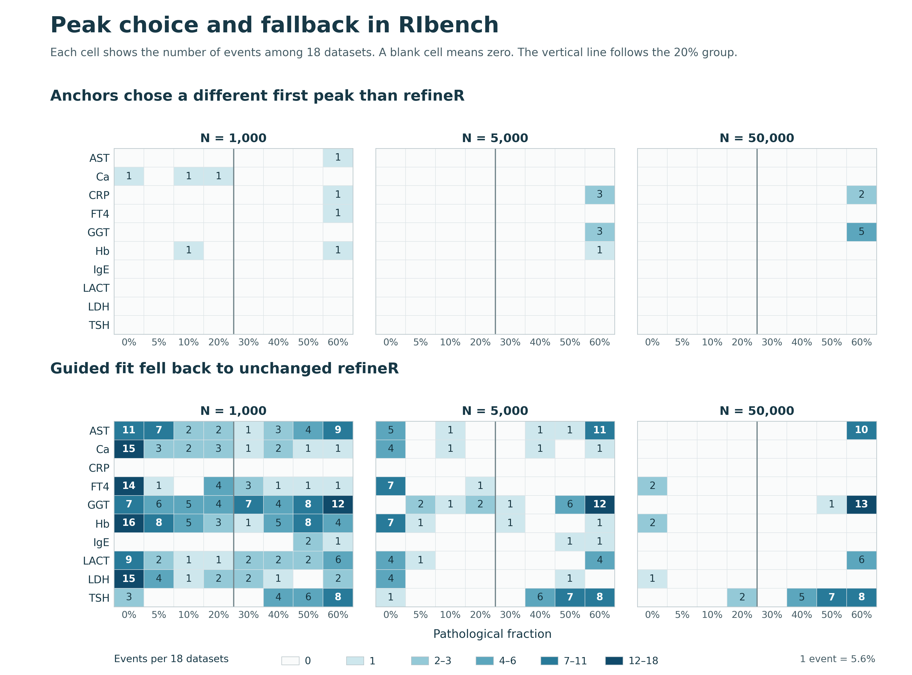

# Stage 2 RIbench results

The frozen K = 24 peak-choice-only candidate met all four native-limit comparisons before checking. Its release met three of four against refineR with the same Stage 1 check. The checked release missed one requirement at N ≤ 5,000 and ≤20% pathology, where it withheld 123 intervals and checked refineR withheld 122. The study included all 4,320 planned RIbench datasets. Work stopped after Stage 2.

## Prespecified gate results

Each row compares the candidate with unchanged refineR on the same routine data and healthy anchors. Loss averages the absolute RIbench endpoint z errors, capping each at 5, with failure or nonreturn scored as 5. CRP contributes only the 95th-percentile upper endpoint. Negative differences favor the candidate. For the checked release, both methods use the primary PIT seed and threshold p < 0.01. Counts are candidate / refineR.

| N | Pathology | Analysis | Datasets | Candidate loss | refineR loss | Difference [95% interval] | Implausible | Nonreturns | Gate |
| --- | --- | --- | --- | --- | --- | --- | --- | --- | --- |
| ≤ 5,000 | >20% | Before check | 1,440 | 0.5748 | 0.5787 | -0.0039 [-0.0090, +0.0006] | 4 / 4 | 0 / 0 | Pass |
| ≤ 5,000 | >20% | After check | 1,440 | 1.3905 | 1.4223 | -0.0318 [-0.0726, +0.0040] | 0 / 0 | 305 / 315 | Pass |
| ≤ 5,000 | ≤20% | Before check | 1,440 | 0.1932 | 0.1907 | +0.0025 [+0.0001, +0.0049] | 0 / 0 | 0 / 0 | Pass |
| ≤ 5,000 | ≤20% | After check | 1,440 | 0.5796 | 0.5754 | +0.0042 [-0.0120, +0.0221] | 0 / 0 | 123 / 122 | Missed (nonreturns) |
| 50,000 | >20% | Before check | 720 | 0.3610 | 0.3653 | -0.0044 [-0.0121, +0.0000] | 0 / 0 | 0 / 0 | Pass |
| 50,000 | >20% | After check | 720 | 0.9535 | 0.9672 | -0.0137 [-0.0339, +0.0000] | 0 / 0 | 104 / 106 | Pass |
| 50,000 | ≤20% | Before check | 720 | 0.0965 | 0.0946 | +0.0019 [+0.0000, +0.0049] | 0 / 0 | 0 / 0 | Pass |
| 50,000 | ≤20% | After check | 720 | 0.3707 | 0.3701 | +0.0006 [-0.0196, +0.0215] | 0 / 0 | 43 / 43 | Pass |

Above 20% pathology, loss must decrease. At or below 20%, the allowed increase is 0.02. In either stratum the candidate must also have no more nonreturns or implausible intervals. Implausibility means the uncapped mean absolute endpoint error exceeds 5. Paired 95% percentile intervals use 2,000 resamples clustered by (analyte, scenario). Gate judgments use the point estimates. Above 20% pathology, the candidate lowered pre-check loss by about 0.004 in both cohorts. Both paired intervals include zero, so the size of this gain is uncertain.

## Peak choice and fallback

A different peak means a clear anchor election chose a different index on the first raw-scale 512-bin density. The first rate includes every assigned dataset. The second uses clear, comparable elections. After a clear election, the peak-only search also tracks that peak on transformed scales. Two methods can therefore choose the same initial peak and fit different limits. The candidate fell back to unchanged refineR on 434 datasets. On 355 the anchors did not identify a clear peak. On the other 79 the guided search fell back after a clear choice. All assigned datasets count in the fallback denominator.

| Group | Assigned | Same | Different / all | Different / clear | Unclear | Unavailable | Fallback / all |
| --- | --- | --- | --- | --- | --- | --- | --- |
| All datasets | 4,320 | 3,943 | 22/4,320 (0.5%) | 22/3,965 (0.6%) | 355 | 0 | 434/4,320 (10.0%) |
| N = 1,000 | 1,440 | 1,181 | 8/1,440 (0.6%) | 8/1,189 (0.7%) | 251 | 0 | 271/1,440 (18.8%) |
| N = 5,000 | 1,440 | 1,356 | 7/1,440 (0.5%) | 7/1,363 (0.5%) | 77 | 0 | 106/1,440 (7.4%) |
| N = 50,000 | 1,440 | 1,406 | 7/1,440 (0.5%) | 7/1,413 (0.5%) | 27 | 0 | 57/1,440 (4.0%) |
| AST | 432 | 388 | 1/432 (0.2%) | 1/389 (0.3%) | 43 | 0 | 68/432 (15.7%) |
| CRP | 432 | 426 | 6/432 (1.4%) | 6/432 (1.4%) | 0 | 0 | 0/432 (0.0%) |
| Ca | 432 | 397 | 3/432 (0.7%) | 3/400 (0.8%) | 32 | 0 | 35/432 (8.1%) |
| FT4 | 432 | 396 | 1/432 (0.2%) | 1/397 (0.3%) | 35 | 0 | 35/432 (8.1%) |
| GGT | 432 | 363 | 8/432 (1.9%) | 8/371 (2.2%) | 61 | 0 | 91/432 (21.1%) |
| Hb | 432 | 373 | 3/432 (0.7%) | 3/376 (0.8%) | 56 | 0 | 62/432 (14.4%) |
| IgE | 432 | 427 | 0/432 (0.0%) | 0/427 (0.0%) | 5 | 0 | 5/432 (1.2%) |
| LACT | 432 | 404 | 0/432 (0.0%) | 0/404 (0.0%) | 28 | 0 | 40/432 (9.3%) |
| LDH | 432 | 401 | 0/432 (0.0%) | 0/401 (0.0%) | 31 | 0 | 33/432 (7.6%) |
| TSH | 432 | 368 | 0/432 (0.0%) | 0/368 (0.0%) | 64 | 0 | 65/432 (15.0%) |
| 0% pathology | 540 | 415 | 1/540 (0.2%) | 1/416 (0.2%) | 124 | 0 | 127/540 (23.5%) |
| 5% pathology | 540 | 506 | 0/540 (0.0%) | 0/506 (0.0%) | 34 | 0 | 35/540 (6.5%) |
| 10% pathology | 540 | 521 | 2/540 (0.4%) | 2/523 (0.4%) | 17 | 0 | 19/540 (3.5%) |
| 20% pathology | 540 | 519 | 1/540 (0.2%) | 1/520 (0.2%) | 20 | 0 | 24/540 (4.4%) |
| 30% pathology | 540 | 521 | 0/540 (0.0%) | 0/521 (0.0%) | 19 | 0 | 19/540 (3.5%) |
| 40% pathology | 540 | 508 | 0/540 (0.0%) | 0/508 (0.0%) | 32 | 0 | 35/540 (6.5%) |
| 50% pathology | 540 | 492 | 0/540 (0.0%) | 0/492 (0.0%) | 48 | 0 | 56/540 (10.4%) |
| 60% pathology | 540 | 461 | 18/540 (3.3%) | 18/479 (3.8%) | 61 | 0 | 119/540 (22.0%) |

Eighteen of the 22 different peak choices occurred at 60% pathology. GGT had the most different choices (8/432) and the most fallbacks (91/432). The downloadable data include all 240 analyte × N × pathological fraction combinations and each marginal group. The cohort reports give paired uncertainty intervals and the step and reason for each fallback. A separate descriptive table shows how the before-check loss difference is distributed across the observed peak choices. For each subgroup, its contribution equals the subgroup mean candidate-minus-refineR difference multiplied by its share of the pathology stratum. [Peak choices and fallbacks](peak-choice-and-fallback.csv) · [Peak choices and loss](peak-choice-and-loss.csv)

Above 20% pathology at N ≤ 5,000, eight datasets completed the guided fit after a different initial peak choice. These accounted for 0.00289 of the 0.00393 reduction in mean loss. At N = 50,000, three such datasets contributed a 0.00517 reduction, partly offset by a 0.00081 increase among fits with the same initial peak. In both cohorts the fallback fits reproduced refineR and contributed zero to the difference.

## Paired comparisons with anchoredRI and anchors-only

Each contrast includes every paired Index. Raw contrasts use the native-limit candidate before checking and the comparator’s original fitted limits. Release contrasts use the primary checked candidate and the comparator’s original reporting rule. Anchors-only reports every fit. Task E arm B permits up to five components, and the improved anchoredRI baseline permits up to three.

| N | Comparator | Analysis | Matched | Candidate loss | Comparator loss | Difference [95% interval] | Nonreturns, candidate / comparator |
| --- | --- | --- | --- | --- | --- | --- | --- |
| ≤ 5,000 | anchoredRI arm B | Raw | 2,880 | 0.3840 | 0.2231 | +0.1609 [+0.0586, +0.2626] | 0 / 0 |
| ≤ 5,000 | anchoredRI arm B | Reported | 2,880 | 0.9850 | 0.3725 | +0.6126 [+0.3948, +0.8396] | 428 / 99 |
| ≤ 5,000 | Improved anchoredRI baseline | Raw | 2,880 | 0.3840 | 0.2886 | +0.0954 [+0.0171, +0.1888] | 0 / 0 |
| ≤ 5,000 | Improved anchoredRI baseline | Reported | 2,880 | 0.9850 | 0.9793 | +0.0058 [-0.5372, +0.4826] | 428 / 474 |
| ≤ 5,000 | Anchors-only | Raw | 2,880 | 0.3840 | 0.2899 | +0.0941 [+0.0029, +0.1892] | 0 / 0 |
| ≤ 5,000 | Anchors-only | Reported | 2,880 | 0.9850 | 0.2899 | +0.6951 [+0.5078, +0.8996] | 428 / 0 |
| 50,000 | anchoredRI arm B | Raw | 1,440 | 0.2287 | 0.3751 | -0.1464 [-0.4067, +0.0564] | 0 / 0 |
| 50,000 | anchoredRI arm B | Reported | 1,440 | 0.6621 | 1.1620 | -0.4999 [-1.2036, +0.0976] | 147 / 305 |
| 50,000 | Improved anchoredRI baseline | Raw | 1,440 | 0.2287 | 0.4280 | -0.1992 [-0.3277, -0.0603] | 0 / 0 |
| 50,000 | Improved anchoredRI baseline | Reported | 1,440 | 0.6621 | 1.4249 | -0.7628 [-1.4128, -0.1668] | 147 / 374 |
| 50,000 | Anchors-only | Raw | 1,440 | 0.2287 | 0.2961 | -0.0674 [-0.1558, +0.0153] | 0 / 0 |
| 50,000 | Anchors-only | Reported | 1,440 | 0.6621 | 0.2961 | +0.3660 [+0.1493, +0.6097] | 147 / 0 |

**Above 20% pathology**, the following means use all 1,440 small-cohort and 720 large-cohort datasets in that stratum. At N ≤ 5,000, Task E arm B had the lowest loss before checking. At N = 50,000, the candidate fitted intervals more accurately on average than either anchoredRI method, while anchors-only had the lowest loss.

| N | Analysis | Candidate | Task E arm B | Improved anchoredRI | Anchors-only |
| --- | --- | --- | --- | --- | --- |
| ≤ 5,000 | Raw | 0.5748 | 0.2423 | 0.3857 | 0.2880 |
| ≤ 5,000 | Released | 1.3905 | 0.4476 | 1.2283 | 0.2880 |
| 50,000 | Raw | 0.3610 | 0.4024 | 0.5232 | 0.3070 |
| 50,000 | Released | 0.9535 | 1.3077 | 1.7447 | 0.3070 |

Comparators used the identical ordered routine and screened-anchor vectors. Each cohort report also gives paired comparisons on jointly returned, scorable intervals, the full three ablations, secondary historical extraction, bad-result capture, good-result loss and alternate-seed reversals. [Comparator sources](../../stage2/ribench/comparators/README.md)

## Reproducibility

- **N ≤ 5,000**. The audit covered 2,880 datasets and 48 same-host and 48 separate-host shard comparisons. All 2,880 baseline fits matched the archive within tolerance. Across hosts the maximum endpoint difference was 0 of reference width and the maximum absolute p-value difference was 0. [Cohort report](../stage2-ribench-small-45316106750/REPORT.md) · [Technical audit](../stage2-ribench-small-45316106750/evidence/audit.json) · [Actions run](https://github.com/amromeo/anchorRefine/actions/runs/45316106750)
- **N = 50,000**. The audit covered 1,440 datasets and 48 same-host and 48 separate-host shard comparisons. All 1,440 baseline fits matched the archive within tolerance. Across hosts the maximum endpoint difference was 0 of reference width and the maximum absolute p-value difference was 0. [Cohort report](../stage2-ribench-large-45326071964/REPORT.md) · [Technical audit](../stage2-ribench-large-45326071964/evidence/audit.json) · [Actions run](https://github.com/amromeo/anchorRefine/actions/runs/45326071964)

[Frozen evaluation plan](../../stage2/ribench/PLAN.md) · [Pre-run source hashes](../../stage2/ribench/SHA256SUMS)
