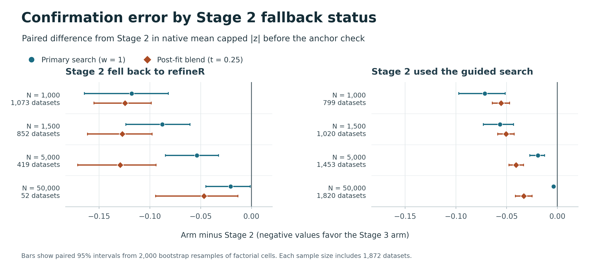

# Stage 3 confirmation

The primary arm (w = 1) and the post-fit comparator (t = 0.25) each passed all eight prespecified comparisons on 7,488 independent synthetic datasets. Both passed the error, implausibility and nonreturn criteria before and after the anchor check. Confirmation used the weights selected on development at every N. RIbench awaits investigator review. [Protocol](../../PROTOCOL.md#stage-3-confirmation-freeze) · [Full confirmation report](../stage3-confirmation-45463873162/REPORT.md) · [Run 45463873162](https://github.com/amromeo/anchorRefine/actions/runs/45463873162)

## Formal gates

The entries are arm minus unchanged refineR in mean capped absolute endpoint z error, using native limits. After checking, both sides use their own guidance-panel decisions. A failed fit or a withheld interval receives a loss of 5. The lower-pathology margin was +0.02. Above 20% pathology the difference had to be strictly negative.

| N | Pathology | Datasets | Primary before | Primary after | Post-fit before | Post-fit after |
| --- | --- | ---: | ---: | ---: | ---: | ---: |
| ≤5,000 | ≤20% | 1,728 | −0.0299 | −0.1662 | −0.0179 | −0.1709 |
| ≤5,000 | >20% | 3,888 | −0.1958 | −0.4797 | −0.2229 | −0.7517 |
| 50,000 | ≤20% | 576 | −0.0017 | −0.0098 | +0.0051 | −0.0374 |
| 50,000 | >20% | 1,296 | −0.2466 | −0.4317 | −0.2919 | −0.9180 |

Both arms fit all 7,488 datasets. After checking, the primary arm returned 6,606 intervals, the post-fit comparator returned 6,951, Stage 2 returned 6,319 and unchanged refineR returned 6,062. Neither frozen arm produced an interval classified as implausible by the protocol. The 32 individual-N comparisons also passed. [Formal gates and paired 95% intervals](../stage3-confirmation-45463873162/confirmation-gates.csv) · [Individual sample sizes](../stage3-confirmation-45463873162/confirmation-gates-by-n.csv)

## Results by Stage 2 fallback status

At N ≤ 5,000, Stage 2 fell back on **2,344 of 5,616 datasets (41.7%)**. Those datasets accounted for **61.1%** of the primary arm’s pre-check improvement over Stage 2 and **65.6%** of the post-fit arm’s improvement. The primary arm also improved the fits on the 3,272 datasets where Stage 2 retained its guided fit.

| N | Stage 2 fit | Datasets | Stage 2 mean error | Primary minus Stage 2 | Post-fit minus Stage 2 |
| --- | --- | ---: | ---: | ---: | ---: |
| ≤5,000 | Fallback | 2,344 | 0.5586 | −0.0954 | −0.1262 |
| ≤5,000 | Non-fallback | 3,272 | 0.2684 | −0.0435 | −0.0474 |
| 50,000 | Fallback | 52 | 0.2659 | −0.0205 | −0.0466 |
| 50,000 | Non-fallback | 1,820 | 0.1808 | −0.0038 | −0.0332 |

At N ≤ 5,000 the primary arm’s pooled mean improvement was 0.0652. Weighting the two groups by their numbers of datasets gives a contribution of 0.0398 from fallback fits and 0.0254 from non-fallback fits. At N = 50,000 only 52 of 1,872 fits fell back. [All parent-subset comparisons, coverage and intervals](../stage3-confirmation-45463873162/parent-comparisons.csv)

## Overlap and shoulder disease at N = 50,000

On the 864 target datasets with 25%, 45% or 60% pathology, pre-check mean error was **0.2883 for Stage 2**, **0.2858 for the primary arm**, **0.2100 for the post-fit comparator** and **0.2563 for anchors-only**. The post-fit arm improved on Stage 2 by 0.0783 and on anchors-only by 0.0463. The primary arm improved on Stage 2 by 0.0025 and remained 0.0295 above anchors-only. On the 432 high-pathology datasets with separated disease, the primary arm had the lowest mean error of these four methods (0.1056). [Target and separated disease, before and after checking](../stage3-confirmation-45463873162/REPORT.md#high-pathology-comparisons-at-n--50000)

## Task G records and reproducibility

The export contains 37,440 scientific-arm fit records plus 14,976 zero-weight identity controls. Each fit has four decision records for the two anchor panels and two PIT seeds. Anchors-only retains its original reporting rule. The index locates the full R object, ordered routine vector and two 40-person panels for each dataset. All 96 same-host repetitions and 96 separate-host comparisons matched. An independent readback restored the saved fits and reproduced both extractions and all finite p-values exactly. [Task G download and restoration guide](../stage3-confirmation-45463873162/TASK-G.md) · [Per-dataset fits](../stage3-confirmation-45463873162/evidence/fits.csv.gz) · [Anchor-check decisions](../stage3-confirmation-45463873162/evidence/checks.csv.gz) · [Dataset index](../stage3-confirmation-45463873162/task-g-index.csv) · [Independent gate checks](independent-verification.json) · [Fit restoration](restoration-verification.json) · [Task G export readback](task-g-readback.json)

The protocol records unit sensitivity inherited from the refineR fitting path. In development, changing units moved a back-converted endpoint by more than 0.1% of interval width on 36 of 720 Stage 2 fits, 35 primary fits and 36 post-fit results. It also records the size-dependent blend as a future study. At t = 0.50, development control error increased by 0.0431 at N = 50,000 after improving at N = 1,000 and 1,500. A size-dependent weight requires new development and confirmation data. [Development observations](../../PROTOCOL.md#stage-3-confirmation-freeze)
