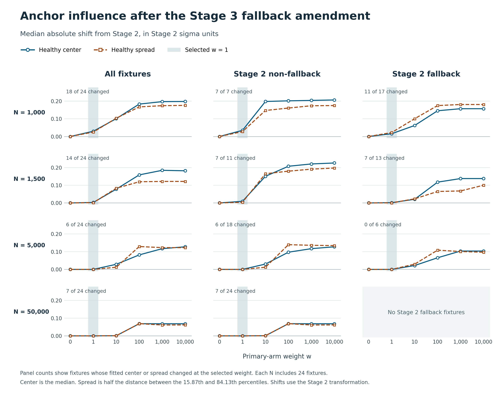

# Stage 3 amended development

The 3,744 development simulations selected **w = 1** for the primary arm, which scores the anchors during the histogram search, and **t = 0.25** for the comparator, which adjusts location and spread after the Stage 2 fit. Each was the only positive weight in its grid to keep the mean increase in control error at or below 0.02 at every sample size. Both weights apply at all four sample sizes. Confirmation remains unopened. [All weights and selection criteria](../stage3-development-45413443007/selection.csv) · [Selection record](selected-weights.json)

## What each weight gained

The entries are differences from the frozen Stage 2 method in pre-check native mean capped absolute endpoint z error. Negative values favor the Stage 3 arm. Each N contributed 288 control datasets at 10% or 20% pathology and 432 target datasets with shoulder or overlapping disease at 25%, 45% or 60% pathology. The remaining 216 datasets per N had separated disease above 20% pathology. A failed fit scores 5. [Paired results and 95% intervals](../stage3-development-45413443007/paired-loss.csv)

| N | Primary control | Primary target | Post-fit control | Post-fit target |
| ---: | ---: | ---: | ---: | ---: |
| 1,000 | −0.06675 | −0.05368 | −0.03095 | −0.07292 |
| 1,500 | −0.04142 | −0.03628 | −0.02268 | −0.07624 |
| 5,000 | −0.01055 | −0.01024 | −0.00418 | −0.07703 |
| 50,000 | −0.00116 | −0.00180 | +0.00514 | −0.07979 |

At N = 50,000 on the target datasets, the mean errors were **0.2873 for Stage 2**, **0.2855 for the primary arm**, **0.2075 for the post-fit comparator** and **0.2519 for anchors-only**. The primary arm narrowed the gap with anchors-only by 0.0018. The post-fit comparator had lower error than anchors-only in these simulations. Stronger weights improved the target result in some cells, but w = 10 raised control error by 0.02130 at N = 5,000 and t = 0.50 raised it by 0.04312 at N = 50,000. The control ceiling was 0.02. [Weight grid](../stage3-development-45413443007/selection.csv)

## What changed on fallback fits

On the 96 frozen influence fixtures, all 36 valid Stage 2 fallback fits entered the unguided histogram search at each positive weight. Of those 180 searches, 160 changed the fit and 20 retained it. At w = 1, 18 of the 36 fallback fits changed. Weight zero reproduced Stage 2 exactly. All non-fallback fixtures matched the original-rule run at every weight for the fitted parameters, both extractions and the anchor checks. [All-fixture table](../stage3-influence-45412130146/REPORT.md#all-fixtures) · [Non-fallback table](../stage3-influence-45412130146/REPORT.md#stage-2-non-fallback-fixtures) · [Fallback table](../stage3-influence-45412130146/REPORT.md#searches-on-stage-2-fallback-fixtures)

In full development, **1,175 of 3,744** Stage 2 fits had used the fallback. At w = 1, all 1,175 entered the weighted search. It changed 692 fits, retained 482 after scoring, and returned the valid parent once when the first pass had no admissible model. That case had N = 1,000 and 60% bilateral separated disease. The comparator adjusted all 1,175. On the 1,174 fallback datasets with both updates available, the mean errors were 0.4892 for the primary arm and 0.4623 for the comparator. [Both-update comparison](../stage3-development-45413443007/REPORT.md#both-selected-updates-available) · [Fit records](../stage3-development-45413443007/evidence/fits.csv.gz)

## Anchor checks and reproducibility

The guidance panel declined 617 Stage 2 fits, 453 primary fits and 281 post-fit results. The corresponding fresh-panel counts were 632, 525 and 448. Both panels caught the two primary fits whose worst endpoint exceeded 5 z units. Neither Stage 2 nor the comparator had a fit above that threshold. The primary arm returned 3,291 intervals after checking and the comparator returned 3,463. All 32 synthetic comparisons against matched unchanged refineR met the prespecified error, implausibility and nonreturn criteria. The formal RIbench gates are still pending. [Accuracy and panel checks](../stage3-development-45413443007/REPORT.md#accuracy-and-coverage) · [Development comparisons](../stage3-development-45413443007/development-gates.csv)

Changing measurement units occasionally changed the fitted intervals materially. Across the 720 sensitivity datasets, multiplying the measurements and rounding increment by 0.1 or 10 moved at least one endpoint by more than 0.1% of its original fitted width on 36 Stage 2 datasets, 35 primary-arm datasets and 36 comparator datasets, after converting back to the original units. The largest movements were 1.77, 1.75 and 1.24 interval widths respectively. This sensitivity was also present in the weight-zero parent. [Sensitivity summary](../stage3-development-45413443007/sensitivity-summary.csv) · [Case-level changes](../stage3-development-45413443007/evidence/sensitivity.csv.gz)

All 96 development shards matched on same-machine repetition and on separate hosts. The audit covered 52,416 fit records, 209,664 checks and 28,800 sensitivity records. Independent calculations reproduced all 132 selection differences to within 3 × 10⁻¹⁶. [Technical audit](../stage3-development-45413443007/evidence/audit.json) · [Independent verification](independent-verification.json)

The original-rule development run was cancelled before any shard wrote a fit table. Its logs, partial artifacts and separate one-case local replay are archived. A typo in the grid verifier interrupted the first amended influence attempt. After the correction, the complete influence and development runs passed on the same frozen source. Only the amended development run supplied the selected weights. [Original-rule development record](../stage3-development-45409118727/REPORT.md) · [Verifier correction](../../stage3/EXECUTION.md) · [Complete amended development report](../stage3-development-45413443007/REPORT.md)
