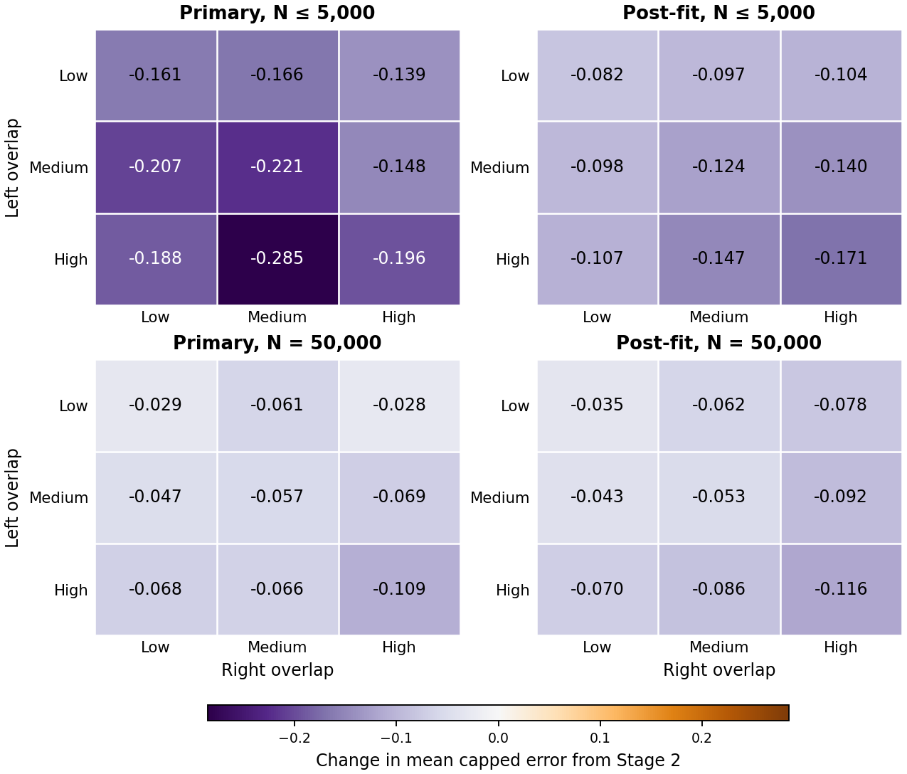

# Stage 3 RIbench results

Both frozen arms passed all four comparisons with unchanged refineR before checking and all four comparisons with checked refineR afterward. The anchor-weighted search used w = 1 and the post-fit blend used t = 0.25. Each ran on 1,440 RIbench datasets at each of N = 1,000, 5,000 and 50,000.

On the 720 datasets with N = 50,000 and >20% pathology, Stage 2 had a mean capped error of 0.3610 and anchors-only had 0.3070, a gap of 0.0540 before checking. The primary arm reduced error by 0.0595 from Stage 2, to 0.3014. The post-fit blend reduced it by 0.0705, to 0.2904. Both point estimates were lower than anchors-only. The paired 95% intervals for the differences from anchors-only included zero for both arms, [-0.1138, +0.0966] for primary and [-0.1206, +0.0838] for post-fit.

At the same N with ≤20% pathology, the post-fit blend increased mean error by +0.0112 against refineR before checking. The point estimate met the prespecified +0.02 margin. The upper end of the paired 95% interval was +0.0217.

## Prespecified comparisons with refineR

Loss is mean absolute endpoint z error, capped at 5 per endpoint. A failed, withheld or unscorable interval contributes 5. CRP contributes only its upper 95th percentile. Negative differences favor Stage 3. Above 20% pathology, loss must fall. At or below 20%, loss may increase by at most 0.02. Each arm must also have at most as many nonreturns and implausible intervals as refineR. An interval is implausible if its uncapped mean absolute endpoint error exceeds 5.

| N | Pathology | Arm | Check | Assigned | Δ vs refineR [95% interval] | Nonreturns¹ | Implausible¹ | Gate |
| --- | --- | --- | --- | --- | --- | --- | --- | --- |
| ≤5,000 | >20% | Primary | Before | 1,440 | -0.1941 [-0.2812, -0.1208] | 0 / 0 | 2 / 4 | Pass |
| ≤5,000 | >20% | Post-fit | Before | 1,440 | -0.1228 [-0.1465, -0.0999] | 0 / 0 | 1 / 4 | Pass |
| ≤5,000 | >20% | Primary | After | 1,440 | -0.6452 [-0.8614, -0.4580] | 135 / 315 | 0 / 0 | Pass |
| ≤5,000 | >20% | Post-fit | After | 1,440 | -0.6009 [-0.7094, -0.4941] | 133 / 315 | 0 / 0 | Pass |
| ≤5,000 | ≤20% | Primary | Before | 1,440 | -0.0258 [-0.0378, -0.0157] | 0 / 0 | 0 / 0 | Pass |
| ≤5,000 | ≤20% | Post-fit | Before | 1,440 | -0.0151 [-0.0218, -0.0095] | 0 / 0 | 0 / 0 | Pass |
| ≤5,000 | ≤20% | Primary | After | 1,440 | -0.2744 [-0.3739, -0.1862] | 42 / 122 | 0 / 0 | Pass |
| ≤5,000 | ≤20% | Post-fit | After | 1,440 | -0.2571 [-0.3565, -0.1766] | 46 / 122 | 0 / 0 | Pass |
| 50,000 | >20% | Primary | Before | 720 | -0.0639 [-0.0981, -0.0344] | 0 / 0 | 0 / 0 | Pass |
| 50,000 | >20% | Post-fit | Before | 720 | -0.0749 [-0.0995, -0.0517] | 0 / 0 | 0 / 0 | Pass |
| 50,000 | >20% | Primary | After | 720 | -0.2486 [-0.3550, -0.1511] | 69 / 106 | 0 / 0 | Pass |
| 50,000 | >20% | Post-fit | After | 720 | -0.4795 [-0.6321, -0.3457] | 35 / 106 | 0 / 0 | Pass |
| 50,000 | ≤20% | Primary | Before | 720 | -0.0034 [-0.0094, +0.0012] | 0 / 0 | 0 / 0 | Pass |
| 50,000 | ≤20% | Post-fit | Before | 720 | +0.0112 [-0.0015, +0.0217] | 0 / 0 | 0 / 0 | Pass |
| 50,000 | ≤20% | Primary | After | 720 | -0.1091 [-0.2367, -0.0195] | 26 / 43 | 0 / 0 | Pass |
| 50,000 | ≤20% | Post-fit | After | 720 | -0.1502 [-0.2785, -0.0458] | 18 / 43 | 0 / 0 | Pass |

¹ Counts are Stage 3 / refineR. Both sides used native limits and their own Stage 1 decision at p < 0.01. For each Stage 3 arm, the same 40 anchors guided the fit and supplied the check. A decline scored 5. The checked results describe release under panel reuse. Decisions used the unrounded point estimates. Intervals use 2,000 paired bootstrap resamples of (analyte, scenario) clusters. The per-cohort reports also give the historical limit formula and paired estimates on common returned intervals. [Small report](../stage3-ribench-small-45530368829/REPORT.md) · [Small gates by N](../stage3-ribench-small-45530368829/gates-by-n.csv.gz) · [Large report](../stage3-ribench-large-45541935930/REPORT.md) · [Large gates by N](../stage3-ribench-large-45541935930/gates-by-n.csv.gz)

## Same-dataset comparisons

Entries are mean losses on all assigned datasets. Task E arm B and the improved anchoredRI baseline contribute their original fitted intervals before checking and their original reported intervals afterward. Anchors-only releases each successful fit. Intervals withheld by any method carry the same loss of 5.

| N | Pathology | Check | Paired | refineR | Stage 2 | Primary | Post-fit | Task E arm B | Improved anchoredRI | Anchors-only |
| --- | --- | --- | --- | --- | --- | --- | --- | --- | --- | --- |
| ≤5,000 | >20% | Before | 1,440 | 0.5787 | 0.5748 | 0.3846 | 0.4559 | 0.2423 | 0.3857 | 0.2880 |
| ≤5,000 | >20% | After | 1,440 | 1.4223 | 1.3905 | 0.7771 | 0.8214 | 0.4476 | 1.2283 | 0.2880 |
| ≤5,000 | ≤20% | Before | 1,440 | 0.1907 | 0.1932 | 0.1650 | 0.1757 | 0.2039 | 0.1915 | 0.2918 |
| ≤5,000 | ≤20% | After | 1,440 | 0.5754 | 0.5796 | 0.3010 | 0.3183 | 0.2973 | 0.7302 | 0.2918 |
| 50,000 | >20% | Before | 720 | 0.3653 | 0.3610 | 0.3014 | 0.2904 | 0.4024 | 0.5232 | 0.3070 |
| 50,000 | >20% | After | 720 | 0.9672 | 0.9535 | 0.7185 | 0.4876 | 1.3077 | 1.7447 | 0.3070 |
| 50,000 | ≤20% | Before | 720 | 0.0946 | 0.0965 | 0.0912 | 0.1058 | 0.3478 | 0.3328 | 0.2853 |
| 50,000 | ≤20% | After | 720 | 0.3701 | 0.3707 | 0.2610 | 0.2199 | 1.0163 | 1.1051 | 0.2853 |

Task E arm B had lower mean loss than both Stage 3 arms in the small high-pathology cohort, before and after checking. Before checking, the paired differences from arm B at N = 50,000 and >20% pathology were -0.1010 [-0.3236, +0.0924] for the primary arm and -0.1120 [-0.3220, +0.0707] for the post-fit blend. After checking, the paired differences from arm B at N = 50,000 and >20% pathology were -0.5892 [-1.3027, +0.0490] for the primary arm and -0.8201 [-1.5146, -0.2051] for the post-fit blend.

Release coverage contributed to the large-cohort checked comparison. On the 720 high-pathology datasets, the primary arm returned 651 intervals, the post-fit blend 685, and arm B 548. On the 501 datasets where primary and arm B both returned an interval, primary's mean loss was 0.1240 higher. On the 526 returned by both post-fit and arm B, post-fit loss was 0.1115 higher. [Small matched comparisons](../stage3-ribench-small-45530368829/paired-loss.csv.gz) · [Small gap estimates](../stage3-ribench-small-45530368829/gap.csv.gz) · [Large matched comparisons](../stage3-ribench-large-45541935930/paired-loss.csv.gz) · [Large gap estimates](../stage3-ribench-large-45541935930/gap.csv.gz)

## Stage 2 fallback

The Stage 2 fallback group contains the datasets on which Stage 2 used unchanged refineR. The primary arm could update the fit on the same unguided histogram. The post-fit blend could update location and spread on either path. The table gives changes from Stage 2 on datasets above 20% pathology. Each contribution weights the within-group difference by the fraction of high-pathology datasets in that group.

| N | Stage 2 path | Assigned | Primary before (contribution) | Post-fit before (contribution) | Primary after (contribution) | Post-fit after (contribution) |
| --- | --- | --- | --- | --- | --- | --- |
| ≤5,000 | Fallback | 179 | -0.4708 (-0.0585) | -0.2385 (-0.0296) | -1.3839 (-0.1720) | -0.9197 (-0.1143) |
| ≤5,000 | No fallback | 1,261 | -0.1504 (-0.1317) | -0.1019 (-0.0892) | -0.5040 (-0.4414) | -0.5193 (-0.4548) |
| 50,000 | Fallback | 50 | -0.2811 (-0.0195) | -0.2243 (-0.0156) | -0.6524 (-0.0453) | -0.8417 (-0.0585) |
| 50,000 | No fallback | 670 | -0.0430 (-0.0400) | -0.0590 (-0.0549) | -0.2038 (-0.1896) | -0.4378 (-0.4074) |

At N ≤ 5,000, the primary arm’s per-dataset improvement was larger on fallback cases (0.4708 versus 0.1504 without fallback). Datasets without fallback accounted for 69% of the overall reduction from Stage 2 before checking.

At N = 50,000, the primary arm’s per-dataset improvement was larger on fallback cases (0.2811 versus 0.0430 without fallback). Datasets without fallback accounted for 67% of the overall reduction from Stage 2 before checking.

[Small fallback results by N and pathology](../stage3-ribench-small-45530368829/parent-contributions.csv.gz) · [Large fallback results by N and pathology](../stage3-ribench-large-45541935930/parent-contributions.csv.gz)

## Overlap and pathological fraction

RIbench labels overlap with the healthy distribution separately for the left and right disease components. Each cell below contains 160 small or 80 large datasets with >20% pathology. The numbers show the pre-check change from Stage 2. Negative values indicate a reduction in error.

At both sample sizes, both arms reduced mean loss from Stage 2 in all nine overlap pairs.

Each entry gives the primary / post-fit difference from Stage 2 for that exact pathological fraction.

| Pathological fraction | N ≤5,000 before | N ≤5,000 after | N = 50,000 before | N = 50,000 after |
| --- | --- | --- | --- | --- |
| 0% | -0.0326 / -0.0065 | -0.3815 / -0.3373 | -0.0103 / +0.0338 | -0.1044 / -0.0703 |
| 5% | -0.0299 / -0.0120 | -0.2726 / -0.2008 | -0.0025 / +0.0149 | -0.0004 / -0.0886 |
| 10% | -0.0211 / -0.0213 | -0.2467 / -0.2765 | -0.0043 / +0.0058 | -0.2060 / -0.2523 |
| 20% | -0.0293 / -0.0304 | -0.2136 / -0.2304 | -0.0041 / -0.0173 | -0.1282 / -0.1922 |
| 30% | -0.0596 / -0.0523 | -0.1920 / -0.1987 | -0.0144 / -0.0278 | -0.1140 / -0.2615 |
| 40% | -0.1363 / -0.0916 | -0.4349 / -0.3945 | -0.0322 / -0.0485 | -0.1918 / -0.3373 |
| 50% | -0.2107 / -0.1360 | -0.7022 / -0.7257 | -0.0471 / -0.0760 | -0.1944 / -0.5730 |
| 60% | -0.3541 / -0.1958 | -1.1245 / -0.9574 | -0.1445 / -0.1298 | -0.4396 / -0.6916 |

The paired tables include before- and after-check estimates for every ordered overlap pair, fraction, and Stage 2 fallback status. [Small paired differences](../stage3-ribench-small-45530368829/paired-loss.csv.gz) · [Small overlap assignments](../stage3-ribench-small-45530368829/overlap.csv.gz) · [Large paired differences](../stage3-ribench-large-45541935930/paired-loss.csv.gz) · [Large overlap assignments](../stage3-ribench-large-45541935930/overlap.csv.gz)

## Reproducibility and Task G export

The 10% samples were stratified by nominal N, pathological fraction and analyte. The same-host comparison required exact results. Separate hosts had to agree on branches and check decisions, with endpoints within 0.1% of the reference width and PIT probability differences at most 0.0001. All primary datasets passed the comparisons with archived inputs, fits and decisions.

| N | Audit | Assigned | Repeated | Exact on same host | Within separate-host tolerances | Maximum endpoint Δ / width | Maximum absolute Δp |
| --- | --- | --- | --- | --- | --- | --- | --- |
| ≤5,000 | sampled | 2,880 | 288 | 288 | 288 | 0 | 0 |
| 50,000 | sampled | 1,440 | 144 | 144 | 144 | 0 | 0 |

Independent readback found byte-for-byte agreement with Stage 2 for all 54 members of the six N = 50,000 input groups. [Large input verification](large-input-readback.json) · [Small audit receipt](../stage3-ribench-small-45530368829/evidence/audit.json) · [Small frozen sample indices](../stage3-ribench-small-45530368829/evidence/audit-sample.csv) · [Large audit receipt](../stage3-ribench-large-45541935930/evidence/audit.json) · [Large frozen sample indices](../stage3-ribench-large-45541935930/evidence/audit-sample.csv)

Task G has 30,240 fit records and 60,480 check records covering five scientific arms and two zero-weight controls. Each dataset has one panel of 40 anchors generated with seed 17000000 + Index. The primary and alternate randomized PIT decisions use seeds 38000000 + Index and 39000000 + Index. Both randomize within rounding intervals on the same observations. The archived index locates the serialized fits by RIbench Index. [Small Task G guide](../stage3-ribench-small-45530368829/TASK-G.md) · [Small fit index](../stage3-ribench-small-45530368829/task-g-index.csv) · [Small export manifest](../stage3-ribench-small-45530368829/task-g-manifest.json) · [Large Task G guide](../stage3-ribench-large-45541935930/TASK-G.md) · [Large fit index](../stage3-ribench-large-45541935930/task-g-index.csv) · [Large export manifest](../stage3-ribench-large-45541935930/task-g-manifest.json)

At N ≤ 5,000, changing the PIT seed reversed 14 of 2,880 primary-arm decisions and 13 of 2,880 post-fit decisions. At N = 50,000, changing the PIT seed reversed 6 of 1,440 primary-arm decisions and 1 of 1,440 post-fit decisions. [Small seed reversals](../stage3-ribench-small-45530368829/seed-changes.csv.gz) · [Small bad results caught and good results declined](../stage3-ribench-small-45530368829/rates.csv.gz) · [Large seed reversals](../stage3-ribench-large-45541935930/seed-changes.csv.gz) · [Large bad results caught and good results declined](../stage3-ribench-large-45541935930/rates.csv.gz)

[Frozen protocol](../../PROTOCOL.md) · [Stage 2 RIbench results](../stage2-ribench/REVIEW.md) · [Selected weights](../stage3-development/selected-weights.json) · [Stage 3 confirmation](../stage3-confirmation/REVIEW.md)

An independent calculation from the original worker files reproduced all 16 gate decisions and 25,696 paired comparisons. The largest difference in a confidence interval endpoint was less than 5 × 10⁻¹⁵. The saved models and decisions also passed independent Task G restoration checks. [Small score verification](small-score-readback.json) · [Large score verification](large-score-readback.json) · [Small Task G verification](small-task-g-readback.json) · [Large Task G verification](large-task-g-readback.json)

The first small-cohort attempt was cancelled after a local export check compared vector lengths with nominal N. The second stopped at worker setup when it tried to run Python in the R container. The successful runs verified each export against its observed vector length and ran the Python weight check on Ubuntu. Both used the fitting code and weights from confirmation. [Execution record and original attempts](../../stage3/ribench/EXECUTION.md)
